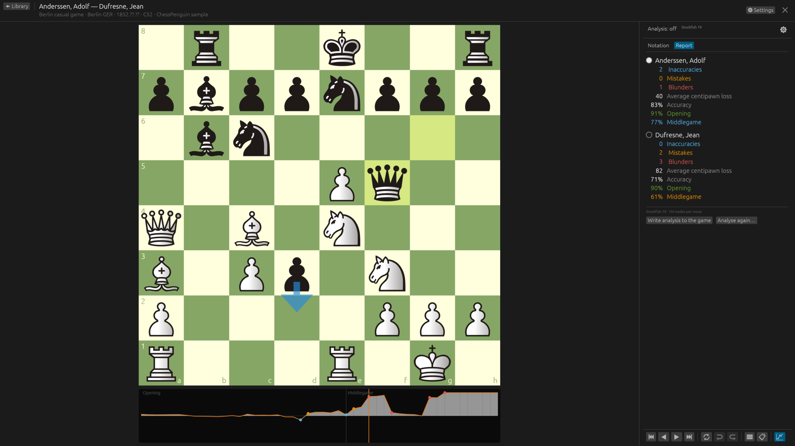
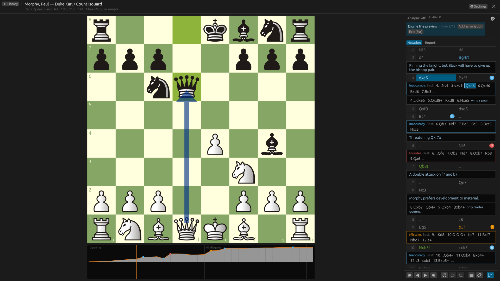
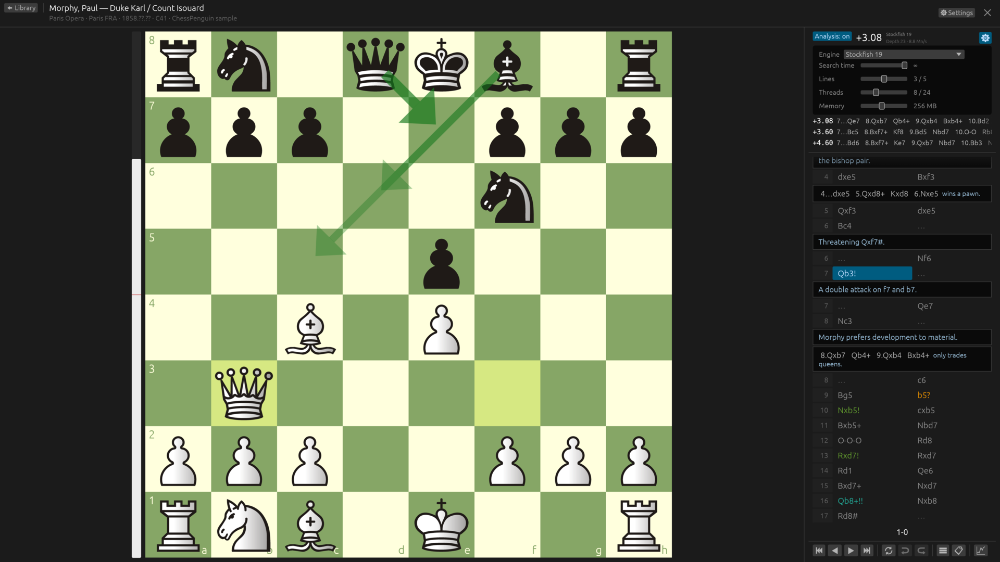

<p align="center">
  
</p>

<h1 align="center">ChessPenguin</h1>

<p align="center">
  A native chess database for Linux: open PGN collections, read annotated games,
  enter your own and analyse them with Stockfish or any UCI engine.
</p>

<p align="center">
  <a href="https://github.com/vrubelroman/chessPenguin/releases/latest">Download</a> ·
  <a href="README.ru.md">Русский</a>
</p>


## Features

- **PGN library** — keep several databases at hand, search and sort games, reopen where you left off.
- **ChessBase and archives** — open ChessBase databases (`.cbh`) and archives (`.cbv`), and `.zip` /
  `.7z` files with PGN or ChessBase inside: games, variations, comments, symbols, arrows and the book
  chapters, read-only (export to PGN by saving a game).
- **Real-world PGN** — nested variations, comments, NAGs, games from a FEN position, legacy
  encodings (windows-1251, windows-1252, KOI8-R, CP866) and teaching null moves (`--`).
  Source files are never modified.
- **Notation** — main line as a two-column table, comments and variations as blocks,
  mouse and keyboard navigation.
- **Stockfish included** — analysis works right after installation; other UCI engines can be added.
- **Engine analysis** — any UCI engine, up to 5 lines, best-move arrows, evaluation bar;
  search time, threads and memory are set right in the analysis panel.
- **Game analysis** — evaluate the whole game in the background: evaluation graph under the board,
  accuracy, inaccuracies, mistakes and blunders per player and per game phase (Lichess method),
  better moves in the notation; write it into the game as NAGs, comments and `[%eval]` (undoable).
- **Engine lines on the board** — step through a line without touching the game, add it as a
  variation with one click (undoable).
- **Editing** — enter moves and variations, promote or delete lines, undo/redo,
  copy PGN/FEN, save a game to a new file.
- **Looks** — 17 piece sets, 37 boards (flat colours and textures), 7 sound sets,
  dark and light themes.
- **Online games** — download anyone's games from Lichess and Chess.com by nickname (yours, a pupil's, an opponent's; no login) into a database, both sites merged or one per site, and fetch the new ones with one click.
- **Languages** — English, Русский, Français, Deutsch, Español, Italiano.

| Game analysis: graph and report | Engine marks and better lines |
| --- | --- |
|  |  |
| **Engine settings in the analysis panel** | **Library** |
|  |  |
| **Boards and pieces** | |
|  | |

## Install

Packages for every release are on the [Releases](https://github.com/vrubelroman/chessPenguin/releases) page.

| Format | Command |
| --- | --- |
| Debian / Ubuntu | `sudo apt install ./chesspenguin_<version>_amd64.deb` |
| Fedora / openSUSE | `sudo dnf install ./chesspenguin-<version>-1.x86_64.rpm` |
| Arch Linux | `sudo pacman -U ./chesspenguin-<version>-1-x86_64.pkg.tar.zst` |
| Any distribution | `chmod +x ChessPenguin-<version>-x86_64.AppImage && ./ChessPenguin-<version>-x86_64.AppImage` |
| Flatpak | `flatpak install --user ChessPenguin-<version>-x86_64.flatpak` |
| Windows | unzip `ChessPenguin-<version>-windows-x86_64.zip`, run `ChessPenguin.exe` |
| macOS (Apple Silicon) | open `ChessPenguin-<version>-macos-arm64.dmg`, drag ChessPenguin to Applications |
| Android 12+ (alpha) | open `ChessPenguin-<version>-android.apk` (Stockfish built in) or `…-android-noengine.apk` (Stockfish downloaded in the app) on the phone |

On macOS the app is not signed by Apple yet: the first time, right-click ChessPenguin in
Applications and choose **Open** (on macOS 15: System Settings → Privacy & Security → Open Anyway).

**Stockfish** is one click away: the first time you analyse, ChessPenguin offers to download the
official Stockfish 19 (about 80 MB, checked before use, installed for your account only); the
button is also in **Settings → Engines**. A `stockfish` installed on the system is found
automatically, any other UCI engine can be added from a file. The Flatpak includes Stockfish.

The **Android app** (alpha) views databases and games (the same formats), with the notation under
the board and Stockfish. The two APKs install over each other; databases and settings are kept.

### Build from source

Rust 1.97 or newer. On Debian/Ubuntu: `sudo apt install pkg-config libasound2-dev libxkbcommon-dev libwayland-dev`.

```sh
cargo run --release -p chesspenguin -- examples/classics.pgn
./scripts/install.sh              # install for the current user (~/.local) with Stockfish; --no-stockfish, --uninstall
```

## Keyboard

| Where | Keys |
| --- | --- |
| Library | ↑/↓ select · Enter open · Ctrl+O add PGN · Ctrl+N new game · Ctrl+F search |
| Game | ←/→ move · ↑/↓ switch variation · Home/End · F flip · L engine · Shift+A game analysis · Esc leave preview |
| Editing | Ctrl+Z / Ctrl+Y undo/redo · Ctrl+Shift+C copy PGN · Ctrl+S save as · Ctrl+W back to library |

## Project layout

- `crates/chess-core` — game tree, tolerant PGN import/export.
- `crates/uci` — UCI engine process supervisor.
- `apps/desktop` — the egui application.
- `crates/mobile-api`, `androidApp` — the core for the Android app and the app itself.
- `packaging/` — desktop entry, AppStream metadata, icons, deb/rpm, AppImage and Flatpak recipes.

The Android app is `androidApp/` (Kotlin, Jetpack Compose) over the same Rust core
(`crates/mobile-api`, UniFFI); `androidApp/scripts/release.sh` builds the two signed APKs.

Releases are built by GitHub Actions when a `v*` tag is pushed (see `.github/workflows/release.yml`).

## License

GPL-3.0-or-later. Third-party piece sets, boards and sounds come from
[Lichess](https://github.com/lichess-org/lila) under their own free licenses —
see [THIRD_PARTY_NOTICES.md](THIRD_PARTY_NOTICES.md).
