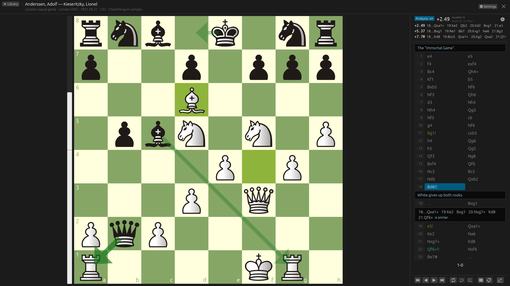
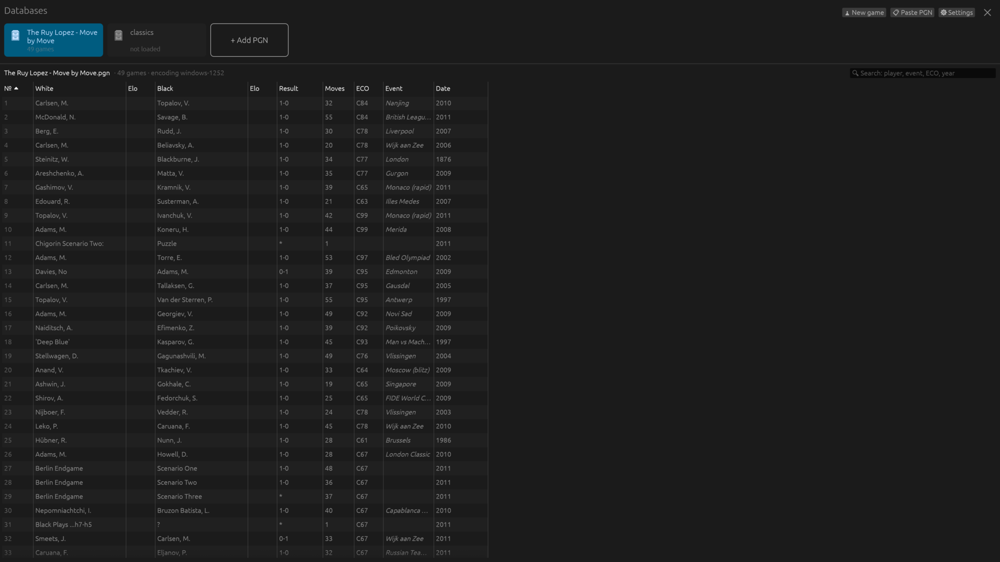
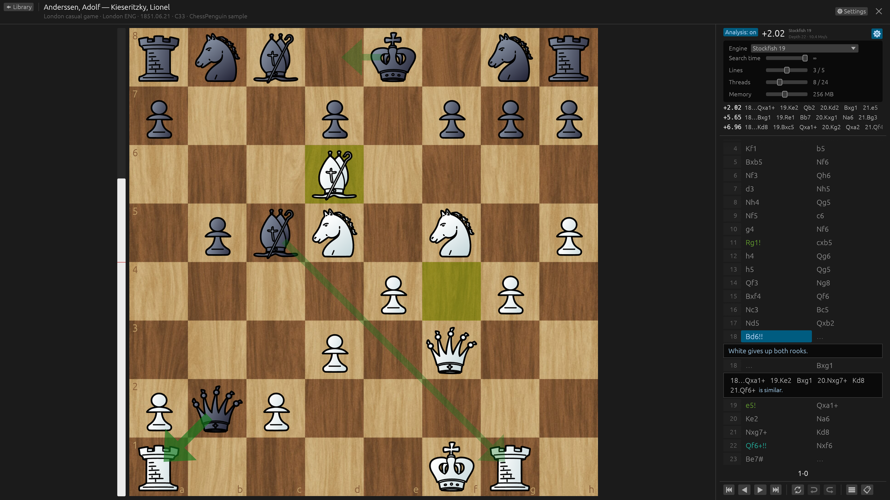
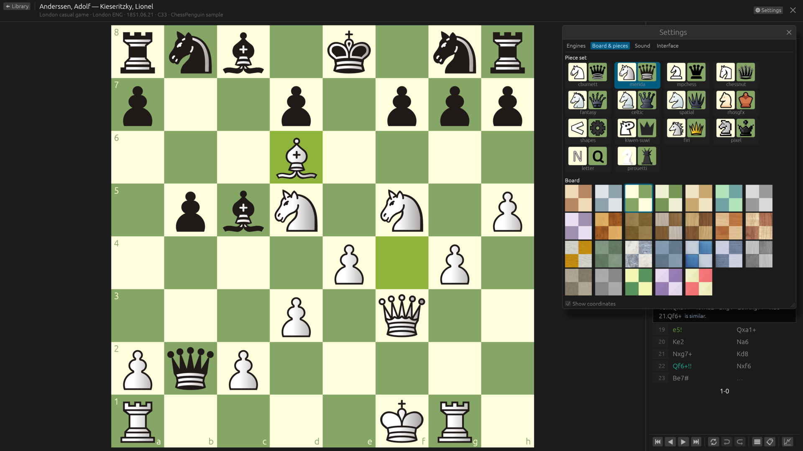

<p align="center">
  
</p>

<h1 align="center">ChessPenguin</h1>

<p align="center">
  A native chess database for Linux: open PGN collections, read annotated games,
  enter your own and analyse them with Stockfish or any UCI engine.
</p>

<p align="center">
  <a href="https://github.com/vrubelroman/chessPenguin/releases/latest">Download</a> ·
  <a href="README.ru.md">Русский</a>
</p>



## Features

- **PGN library** — keep several databases at hand, search and sort games, reopen where you left off.
- **Real-world PGN** — nested variations, comments, NAGs, games from a FEN position, legacy
  encodings (windows-1251, windows-1252, KOI8-R, CP866) and teaching null moves (`--`).
  Source files are never modified.
- **Notation** — main line as a two-column table, comments and variations as blocks,
  mouse and keyboard navigation.
- **Stockfish included** — analysis works right after installation; other UCI engines can be added.
- **Engine analysis** — any UCI engine, up to 5 lines, best-move arrows, evaluation bar;
  search time, threads and memory are set right in the analysis panel.
- **Game analysis** — evaluate the whole game in the background: evaluation graph under the board,
  accuracy, inaccuracies, mistakes and blunders per player and per game phase (Lichess method),
  better moves in the notation; write it into the game as NAGs, comments and `[%eval]` (undoable).
- **Engine lines on the board** — step through a line without touching the game, add it as a
  variation with one click (undoable).
- **Editing** — enter moves and variations, promote or delete lines, undo/redo,
  copy PGN/FEN, save a game to a new file.
- **Looks** — 14 piece sets and 26 boards (flat colours and textures from Lichess),
  sounds, dark and light themes.
- **Languages** — English, Русский, Français, Deutsch, Español, Italiano.

| Library | Variations and engine settings | Boards and pieces |
| --- | --- | --- |
|  |  |  |

## Install

Packages for every release are on the [Releases](https://github.com/vrubelroman/chessPenguin/releases) page.

| Format | Command |
| --- | --- |
| Debian / Ubuntu | `sudo apt install ./chesspenguin_<version>_amd64.deb` |
| Fedora / openSUSE | `sudo dnf install ./chesspenguin-<version>-1.x86_64.rpm` |
| Arch Linux | `sudo pacman -U ./chesspenguin-<version>-1-x86_64.pkg.tar.zst` |
| Any distribution | `chmod +x ChessPenguin-<version>-x86_64.AppImage && ./ChessPenguin-<version>-x86_64.AppImage` |
| Flatpak | `flatpak install --user ChessPenguin-<version>-x86_64.flatpak` |
| Windows | unzip `ChessPenguin-<version>-windows-x86_64.zip`, run `ChessPenguin.exe` |

**Stockfish 19 is included** and set up on the first start: install and analyse. A `stockfish`
from your distribution is found too, and any other UCI engine can be added in **Settings → Engines**.

### Build from source

Rust 1.97 or newer. On Debian/Ubuntu: `sudo apt install pkg-config libasound2-dev libxkbcommon-dev libwayland-dev`.

```sh
cargo run --release -p chesspenguin -- examples/classics.pgn
./scripts/install.sh              # install for the current user (~/.local) with Stockfish; --no-stockfish, --uninstall
```

## Keyboard

| Where | Keys |
| --- | --- |
| Library | ↑/↓ select · Enter open · Ctrl+O add PGN · Ctrl+N new game · Ctrl+F search |
| Game | ←/→ move · ↑/↓ switch variation · Home/End · F flip · L engine · Shift+A game analysis · Esc leave preview |
| Editing | Ctrl+Z / Ctrl+Y undo/redo · Ctrl+Shift+C copy PGN · Ctrl+S save as · Ctrl+W back to library |

## Project layout

- `crates/chess-core` — game tree, tolerant PGN import/export.
- `crates/uci` — UCI engine process supervisor.
- `apps/desktop` — the egui application.
- `packaging/` — desktop entry, AppStream metadata, icons, deb/rpm, AppImage and Flatpak recipes.

Releases are built by GitHub Actions when a `v*` tag is pushed (see `.github/workflows/release.yml`).

## License

GPL-3.0-or-later. Third-party piece sets, boards and sounds come from
[Lichess](https://github.com/lichess-org/lila) under their own free licenses —
see [THIRD_PARTY_NOTICES.md](THIRD_PARTY_NOTICES.md).
