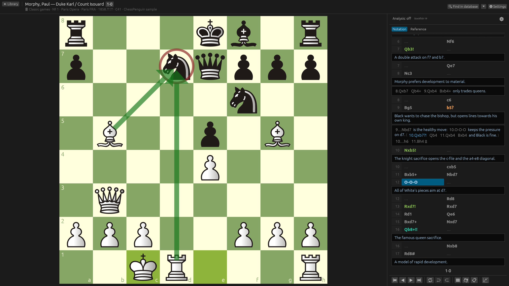
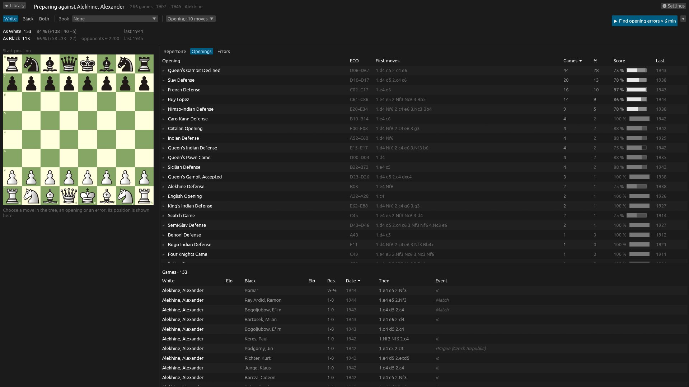
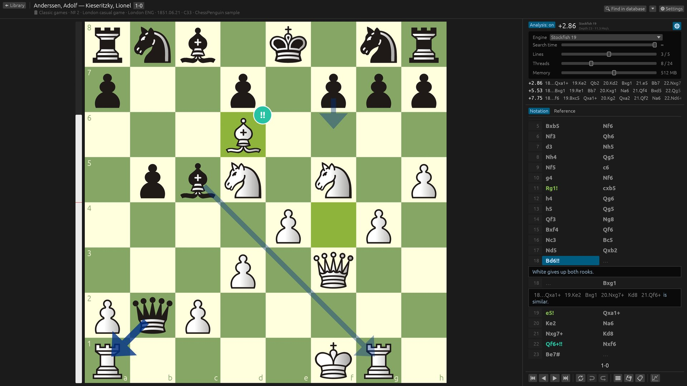
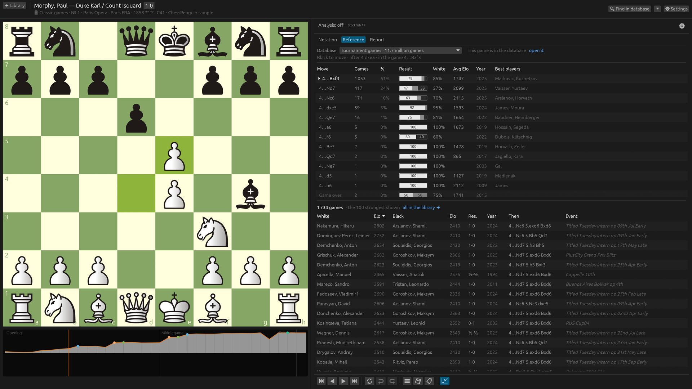
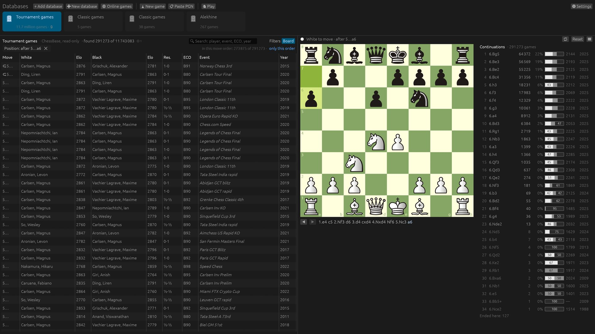
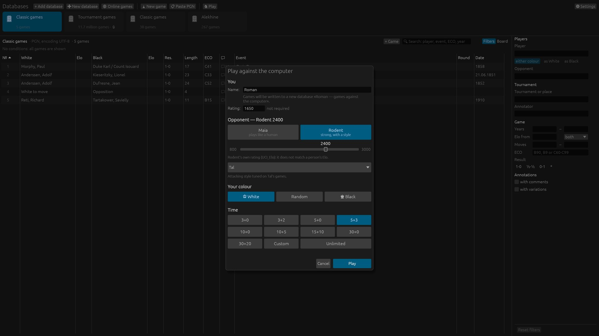
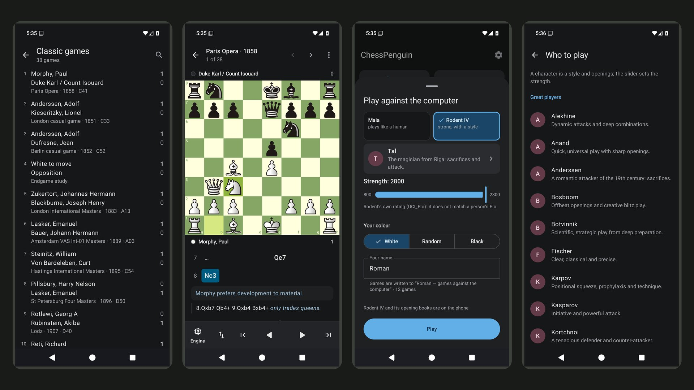
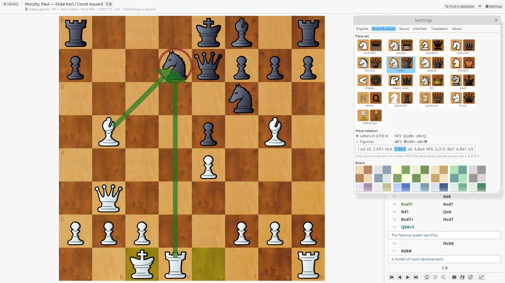

# ChessPenguin

Шахматная база для Linux, Windows, macOS и Android: открывайте сборники PGN и ChessBase, читайте
аннотированные партии, вводите свои, анализируйте их со Stockfish, готовьтесь к сопернику и
играйте с компьютером.

[English](README.md) · [Скачать](https://github.com/vrubelroman/chessPenguin/releases/latest)

Скриншоты — английского интерфейса; в программе девять языков, русский среди них.

## Возможности

- **Библиотека PGN** — несколько баз под рукой, поиск и сортировка партий, возврат к той же строке.
- **ChessBase и архивы** — базы ChessBase (`.cbh`) и архивы (`.cbv`), а также `.zip` / `.7z` с PGN
  или ChessBase внутри: партии, варианты, комментарии, знаки, стрелки и текстовые главы книг; только
  чтение (в PGN — сохранением партии).
- **Реальные PGN** — вложенные варианты, комментарии, NAG, партии из позиции FEN, старые кодировки
  (windows-1251, windows-1252, KOI8-R, CP866) и учебные нулевые ходы `--`. Исходные файлы не изменяются.
- **Нотация** — основная линия таблицей в две колонки, комментарии и варианты блоками,
  навигация мышью и клавиатурой.
- **Справочник** — какие ходы делали из текущей позиции в базе с полки (для теории — в большой),
  их статистика, сколько партия держится в базе, сильнейшие партии с этой позицией.
- **Поиск по позиции** — расставьте ходы на доске и отфильтруйте базу на миллионы партий по
  позиции, рядом — фильтры по игроку, годам, рейтингу, дебюту и результату.
- **Анализ движком** — любой UCI-движок, до 5 линий, стрелки лучших ходов, шкала оценки;
  время, потоки и память настраиваются прямо в панели анализа.
- **Разбор партии** — оценка всей партии в фоне: график под доской, точность, неточности, ошибки
  и зевки каждого игрока и по стадиям партии (методика Lichess), **блестящие (!!) и
  замечательные (!) ходы**, сверенные с отметками chess.com на известных партиях, лучшие ходы в
  нотации и значки на доске; запись разбора в партию знаками, комментариями и `[%eval]` (с
  отменой). Разбор всегда идёт на одних и тех же параметрах движка, поэтому у партии одинаковые
  отметки на любом компьютере и телефоне.
- **Подготовка к сопернику** — выберите игрока базы и посмотрите его дебютный репертуар за белых и
  за чёрных: дерево его ходов с названиями дебютов, партиями, счётом и датой последней партии,
  таблица дебютов и вариантов с первыми ходами, где он уходит из теории; по кнопке движок находит
  его ошибки в дебютах — по дебютам и те, что он повторяет. Все таблицы сортируются по колонкам.
- **Линии движка на доске** — просмотр линии без изменения партии и вставка её вариантом (с отменой).
- **Редактирование** — ввод ходов и вариантов, повышение и удаление линий, отмена/повтор,
  копирование PGN/FEN, сохранение партии в новый файл.
- **Вставка варианта** — ходы или целая партия PGN из буфера встают в открытую партию вариантом
  с того места, где расходятся, с комментариями и вариантами (Ctrl+V).
- **Изучение дебюта** — повторите по памяти ходы обеих сторон партии до выбранного хода; ошибки
  считаются, прохождения каждой линии запоминаются. Или продолжите партию с любого хода против Maia.
- **Игра с компьютером** — Maia, нейросеть, обученная на партиях людей, играет как человек
  выбранного уровня, вместе с ошибками (600–2600 по её собственной шкале); Rodent — сильный
  движок с характером: стили, характеры и 22 великих шахматиста от Морфи до Каспарова
  (Rodent V и Rodent IV, 800–3000). Контроль времени как на
  Lichess (от 3+0 до 30+20, свой, бессрочно), часы, предходы, ход назад, предложение ничьей;
  в проигранной позиции соперник предлагает сдаться. Сыгранные партии сами записываются в базу
  игрока. Maia (316 МБ) и Rodent (48 и 70 МБ) скачиваются по кнопке.
- **Оформление** — 17 наборов фигур, 37 досок (цвета и текстуры), 7 наборов звуков, тёмная и светлая тема.
- **Онлайн-партии** — партии любого игрока с Lichess и Chess.com по нику (без входа) в базу; новые партии приходят сами.
- **100 классических партий** встроены — от Андерсена и Морфи до Карлсена, знаменитые — с
  короткими введениями; встроенные базы обновляются вместе с программой.
- **Приложение для Android** — базы и партии тех же форматов, ходы на доске, свои базы, разбор
  партии с !! и !, игра с Maia, изучение дебюта.
- **Языки** — English, Русский, Français, Deutsch, Español, Italiano, Português, Oʻzbekcha, Қазақша.

| Подготовка к сопернику | Разбор партии: отчёт, !! и ! |
| --- | --- |
|  |  |
| **Анализ движком** | **Справочник: что здесь играли** |
|  |  |
| **Библиотека с фильтрами** | **Поиск по позиции** |
|  |  |
| **Игра с компьютером** | **Android** |
|  |  |
| **Доски, фигуры и светлая тема** | |
|  | |

## Установка

Пакеты каждого релиза — на странице [Releases](https://github.com/vrubelroman/chessPenguin/releases):
`.deb`, `.rpm`, AppImage, Flatpak, архив для Windows и `.dmg` для macOS на Apple Silicon (приложение пока
не подписано Apple: в первый раз — правый клик → «Открыть»). Команды установки — в [README.md](README.md#install).

**Stockfish — в один клик:** при первом анализе ChessPenguin предложит скачать официальный
Stockfish 19 (около 80 МБ, проверяется перед запуском, ставится только для вас); та же кнопка есть
в **Настройки → Движки**. Установленный в системе `stockfish` находится сам, другие UCI-движки
добавляются из файла. Во Flatpak Stockfish уже есть.

**Android 12+:** базы и партии (те же форматы), нотация под доской, Stockfish; ходы на доске
(варианты, отмена), свои базы на телефоне, разбор партии с !! и !, игра с Maia и Rodent IV,
изучение дебюта.
Две сборки: `ChessPenguin-<версия>-android.apk` — Stockfish уже внутри, `…-android-noengine.apk` —
Stockfish скачивается в приложении. Ставятся одна поверх другой, базы и настройки сохраняются.

Сборка из исходников: Rust 1.97+, затем `cargo run --release -p chesspenguin`
или `./scripts/install.sh` для установки в `~/.local` вместе со Stockfish (`--no-stockfish` — без него).

## Лицензия

GPL-3.0-or-later. Наборы фигур, доски и звуки — из [Lichess](https://github.com/lichess-org/lila)
под собственными свободными лицензиями, см. [THIRD_PARTY_NOTICES.md](THIRD_PARTY_NOTICES.md).
