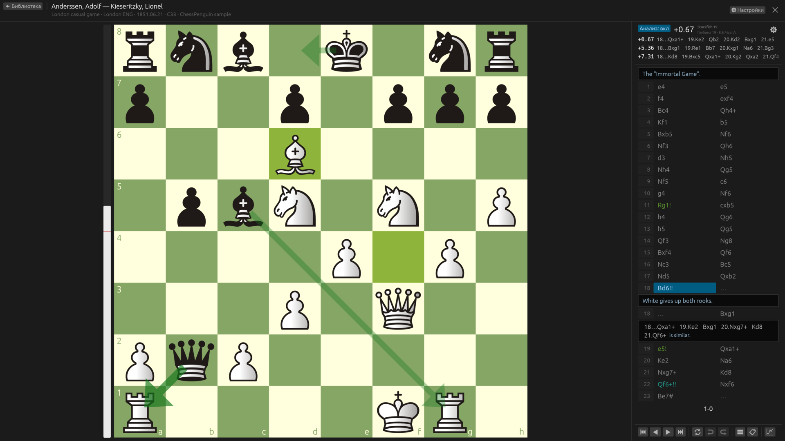
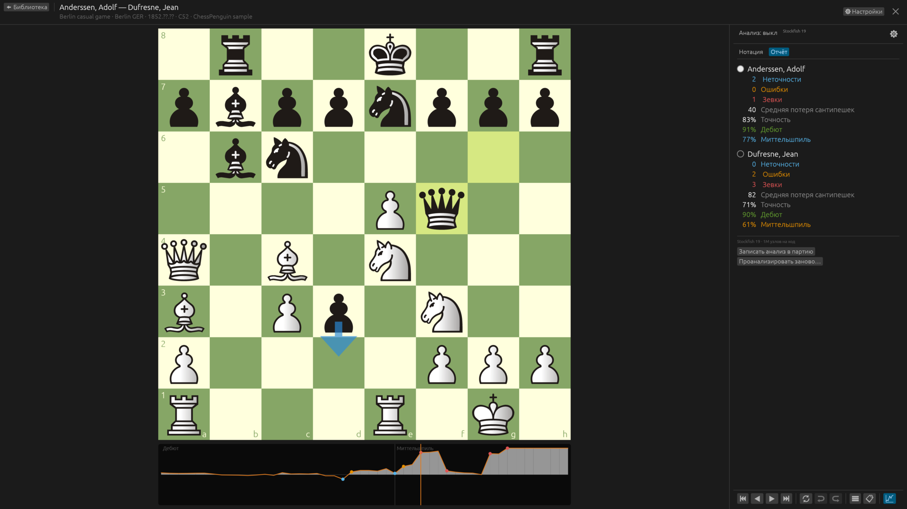
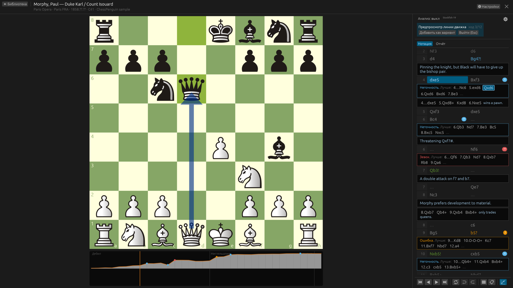
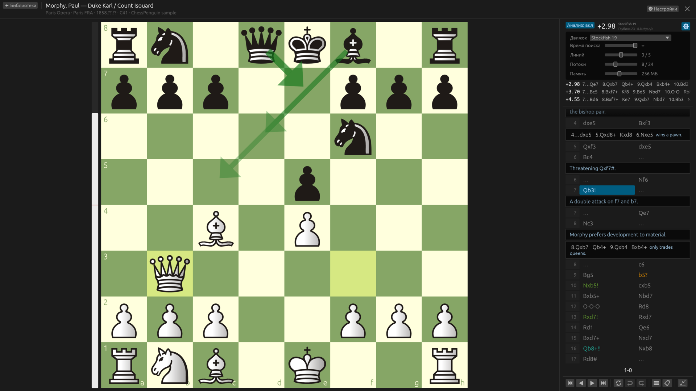
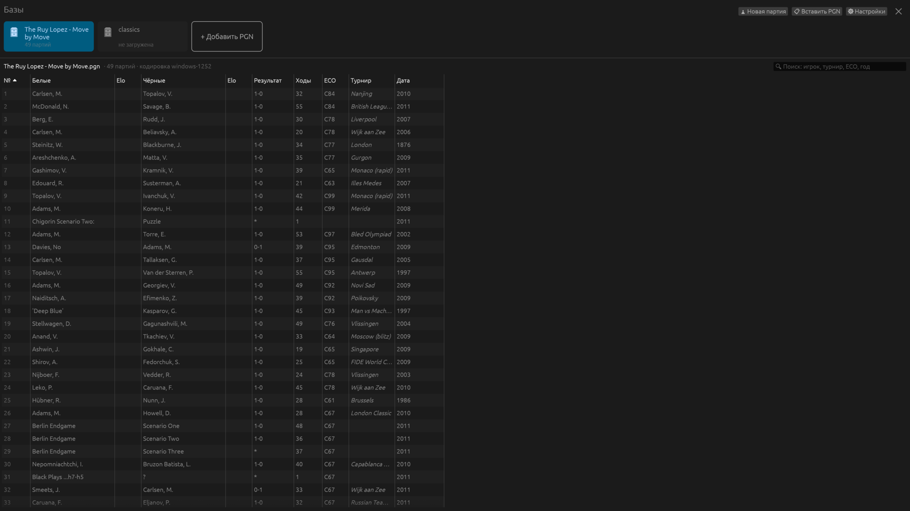
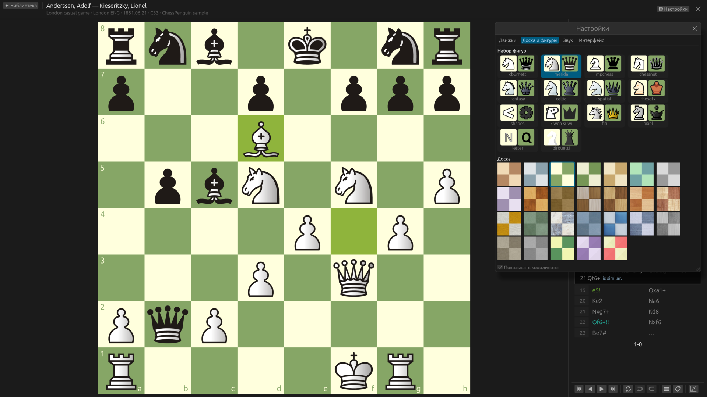

# ChessPenguin

Нативная шахматная база для Linux: открывайте PGN-сборники, читайте аннотированные партии,
вводите свои и анализируйте их со Stockfish или любым UCI-движком.

[English](README.md) · [Скачать](https://github.com/vrubelroman/chessPenguin/releases/latest)

## Возможности

- **Библиотека PGN** — несколько баз под рукой, поиск и сортировка партий, возврат к той же строке.
- **ChessBase и архивы** — базы ChessBase (`.cbh`) и архивы (`.cbv`), а также `.zip` / `.7z` с PGN
  или ChessBase внутри: партии, варианты, комментарии, знаки, стрелки и текстовые главы книг; только
  чтение (в PGN — сохранением партии).
- **Реальные PGN** — вложенные варианты, комментарии, NAG, партии из позиции FEN, старые кодировки
  (windows-1251, windows-1252, KOI8-R, CP866) и учебные нулевые ходы `--`. Исходные файлы не изменяются.
- **Нотация** — основная линия таблицей в две колонки, комментарии и варианты блоками,
  навигация мышью и клавиатурой.
- **Анализ движком** — любой UCI-движок, до 5 линий, стрелки лучших ходов, шкала оценки;
  время, потоки и память настраиваются прямо в панели анализа.
- **Анализ партии** — оценка всей партии в фоне: график под доской, точность, неточности, ошибки
  и зевки каждого игрока и по стадиям партии (методика Lichess), лучшие ходы в нотации;
  запись анализа в партию знаками, комментариями и `[%eval]` (с отменой).
- **Линии движка на доске** — просмотр линии без изменения партии и вставка её вариантом (с отменой).
- **Редактирование** — ввод ходов и вариантов, повышение и удаление линий, отмена/повтор,
  копирование PGN/FEN, сохранение партии в новый файл.
- **Оформление** — 17 наборов фигур, 37 досок (цвета и текстуры), 7 наборов звуков, тёмная и светлая тема.
- **Языки** — English, Русский, Français, Deutsch, Español, Italiano.

| Анализ партии: график и отчёт | Отметки движка и лучшие варианты |
| --- | --- |
|  |  |
| **Настройки движка в панели анализа** | **Библиотека** |
|  |  |
| **Доски и фигуры** | |
|  | |

## Установка

Пакеты каждого релиза — на странице [Releases](https://github.com/vrubelroman/chessPenguin/releases):
`.deb`, `.rpm`, AppImage, Flatpak, архив для Windows и `.dmg` для macOS на Apple Silicon (приложение пока
не подписано Apple: в первый раз — правый клик → «Открыть»). Команды установки — в [README.md](README.md#install).

**Stockfish — в один клик:** при первом анализе ChessPenguin предложит скачать официальный
Stockfish 19 (около 80 МБ, проверяется перед запуском, ставится только для вас); та же кнопка есть
в **Настройки → Движки**. Установленный в системе `stockfish` находится сам, другие UCI-движки
добавляются из файла. Во Flatpak Stockfish уже есть.

Сборка из исходников: Rust 1.97+, затем `cargo run --release -p chesspenguin`
или `./scripts/install.sh` для установки в `~/.local` вместе со Stockfish (`--no-stockfish` — без него).

## Лицензия

GPL-3.0-or-later. Наборы фигур, доски и звуки — из [Lichess](https://github.com/lichess-org/lila)
под собственными свободными лицензиями, см. [THIRD_PARTY_NOTICES.md](THIRD_PARTY_NOTICES.md).
